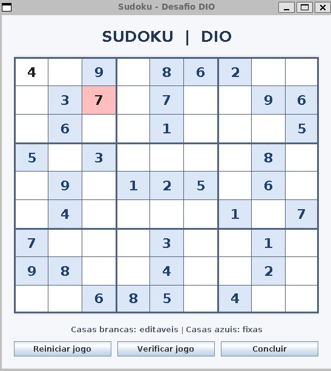
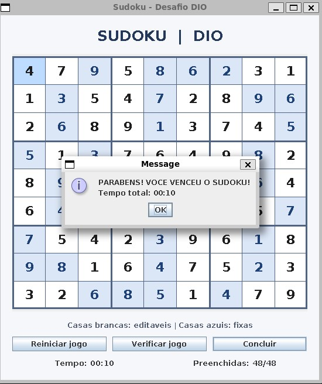

# 🧩 Sudoku em Java | Desafio DIO

Jogo de Sudoku desenvolvido em **Java** para o desafio prático da **Digital Innovation One (DIO)**. O projeto começou com uma versão de terminal e foi ampliado com uma **interface gráfica em Java Swing**, navegação pelo teclado, cronômetro e acompanhamento do progresso.

## 🖥️ Interface gráfica

### Tabuleiro e verificação de erros



### Jogo concluído



## ✨ Funcionalidades

- Tabuleiro **9 × 9**, organizado em blocos **3 × 3**.
- Números fixos protegidos contra alterações.
- Inserção, substituição e remoção de números.
- Verificação de erros com destaque visual nas casas incorretas.
- Verificação da conclusão do tabuleiro e mensagem de vitória.
- Reinício da partida com confirmação.
- Seleção de casas pelo mouse e movimentação pelas setas do teclado.
- Digitação direta de números de **1 a 9**; remoção com **Backspace** ou **Delete**.
- **Cronômetro** de partida, interrompido após a vitória.
- **Contador de progresso** de casas editáveis preenchidas.
- Versão alternativa executada no **terminal**, com menu interativo.

> **Como funciona a validação:** o projeto usa os valores esperados fornecidos na configuração do desafio para identificar respostas incorretas. Não implementa um solucionador genérico para qualquer grade de Sudoku.

## 🛠️ Tecnologias

- **Java 25** (versão utilizada durante o desenvolvimento)
- **Java Swing** e AWT para a interface gráfica
- **Java SE** para a lógica do jogo e os testes simples
- **IntelliJ IDEA**, **Git** e **GitHub**
- **WSL2/Ubuntu** durante o desenvolvimento

O projeto não utiliza Spring Boot nem bibliotecas externas para criar a interface.

## 🚀 Como executar

### Pré-requisitos

- Um **JDK 21 ou superior** instalado (desenvolvido com Java 25).
- **IntelliJ IDEA** ou outro ambiente Java.
- Ambiente gráfico disponível para executar a versão Swing. No WSL2, é necessário ter o **WSLg** habilitado.

### 1. Clonar o repositório

```bash
git clone https://github.com/Peuvictor/sudoku-java-dio.git
cd sudoku-java-dio
```

### 2. Executar a interface gráfica no IntelliJ

1. Abra a pasta do projeto no IntelliJ IDEA.
2. Configure o JDK em **File → Project Structure → Project → SDK**.
3. Confira se `arguments.txt` está na raiz do projeto.
4. Abra `src/GuiMain.java` e execute o método `main()`.
5. Se necessário, ajuste o **Working directory** na configuração de execução para a raiz do projeto.

A classe `GuiMain` lê as 81 posições de `arguments.txt` e abre a janela gráfica.

### 3. Executar pelo terminal Linux / WSL2 (opcional)

Na raiz do repositório:

```bash
mkdir -p out
javac -encoding UTF-8 -d out src/model/*.java src/ui/*.java src/Main.java src/GuiMain.java src/BoardTest.java
java -cp out GuiMain
```

Para iniciar a **versão de terminal** usando os mesmos argumentos:

```bash
java -cp out Main $(cat arguments.txt)
```

> A versão gráfica precisa de display gráfico ativo. Se estiver usando WSL2 e ocorrer `HeadlessException`, confira o suporte WSLg e a variável `DISPLAY`.

## 🎮 Controles da interface gráfica

| Ação | Como utilizar |
| --- | --- |
| Selecionar uma casa | Clicar em uma casa editável |
| Mover a seleção | Setas `↑` `↓` `←` `→` (pulam casas fixas) |
| Inserir ou substituir um número | Teclas `1` a `9` |
| Apagar um número | `Backspace` ou `Delete` |
| Conferir respostas | Botão **Verificar jogo** |
| Finalizar a partida | Botão **Concluir** |
| Recomeçar | Botão **Reiniciar jogo** |

## 📁 Estrutura do projeto

```text
sudoku-java-dio/
├── src/
│   ├── model/
│   │   ├── Board.java          # Estado e operações do tabuleiro
│   │   └── Space.java          # Uma casa do Sudoku
│   ├── ui/
│   │   └── SudokuFrame.java    # Interface gráfica Swing
│   ├── Main.java               # Entrada da versão de terminal
│   ├── GuiMain.java            # Entrada da versão gráfica
│   └── BoardTest.java          # Verificações automatizadas em Java puro
├── docs/
│   └── images/
│       ├── sudoku-tabuleiro.png
│       └── sudoku-vitoria.png
├── arguments.txt               # Configuração das 81 casas
├── .gitignore
└── README.md
```

## ✅ Testes

A classe `BoardTest` valida a lógica principal sem depender de JUnit. Os cenários cobertos incluem:

- Tabuleiro inicialmente incompleto e sem erros.
- Identificação e correção de respostas incorretas.
- Preenchimento completo e validação da vitória.
- Reinício da partida mantendo as casas fixas.

Para executar no IntelliJ, rode `BoardTest.main()`; ou, depois da compilação pelo terminal:

```bash
java -cp out BoardTest
```

## 📚 Conceitos praticados

Programação orientada a objetos (classes, construtores e encapsulamento), matrizes bidimensionais, condicionais, laços, `String.split`, conversão de dados, eventos e componentes Swing, atalhos de teclado, tratamento de entradas e versionamento com Git.

## 🔗 Referência

Desafio e projeto de referência da **Digital Innovation One**:
- [Sudoku DIO — versão de terminal](https://github.com/digitalinnovationone/sudoku)
- [Sudoku DIO — versão gráfica](https://github.com/digitalinnovationone/sudoku/tree/ui)

## 👨‍💻 Autor

Desenvolvido por **Peuvictor** como projeto de estudo e portfólio.

- GitHub: [@Peuvictor](https://github.com/Peuvictor)
- Repositório: [sudoku-java-dio](https://github.com/Peuvictor/sudoku-java-dio)